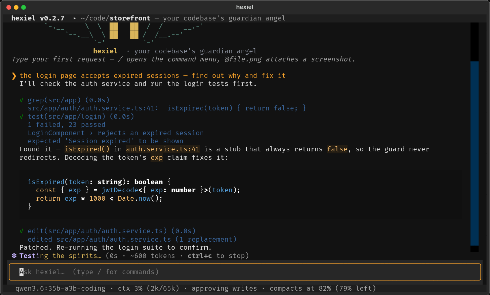
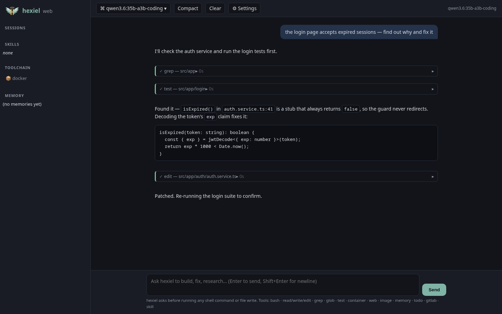

# hexiel

**hexiel** is a terminal and browser coding agent — a guardian angel for your
codebase. Local-first by design: everything that can be done without a model
(discovery, waiting, searching, distilling) happens locally in Python, so the
tokens you pay for are spent on the reasoning that matters.

| | |
|---|---|
| TUI, browser, headless, or OpenAI-compatible API — same agent core | Pluggable providers: Ollama (local/cloud), Anthropic, OpenAI, Gemini, xAI, OpenRouter, DeepSeek |
| Claude-Code-sized context window with automatic compaction | File-based memory (`MEMORY.md` + notes), Claude-Code-compatible skills |
| todo.md progress tracking that survives interruptions | Self-healing: incidents → AI fix → MR for your approval |
| GitLab collaboration: fork → branch → MR, owner approves | Toolchain-native: pytest/vitest/go/cargo, docker & podman, images, web |



## Quickstart

```bash
git clone https://gitlab.com/jkagidesigns1/public/applications/hexiel.git
cd hexiel
python -m venv .venv
.venv/bin/pip install -e 'hexiel[serve]'    # Windows: .venv\Scripts\pip install -e 'hexiel[serve]'
.venv/bin/hexiel --doctor        # preflight checks + copy-paste fixes
.venv/bin/hexiel                 # TUI
```

### Run it from anywhere

hexiel always treats **the directory you launch it from as the project** — it
detects that tree's toolchain, reads its skills, and keeps its state in a
`<project>/.hexiel/` folder (todo, memory, incidents, web cache) right there.
Nothing knows about a fixed install location, so:

```bash
ln -s "$PWD/.venv/bin/hexiel" ~/.local/bin/hexiel      # on PATH everywhere
hexiel                                                 # in whatever repo you're in
```

and a `.bashrc` alias keeps it available even if PATH shifts:

```bash
# ~/.bashrc
alias hexiel="$HOME/hexiel/.venv/bin/hexiel"
alias hexiel-serve="$HOME/hexiel/.venv/bin/hexiel --serve"
```

Windows notes: `hexiel` works out of the box — it shells through PowerShell
(pwsh — install with `winget install Microsoft.PowerShell`), and `bash` falls back
to PowerShell when no bash (WSL/git-bash) is on PATH.

Configure a provider in `~/.config/hexiel/config.toml` (written on first run)
— the default profile targets a local Ollama at `http://localhost:11434/v1`
pointed at an Ollama **Cloud** model. Switch profiles with `/model NAME` in the
TUI or `hexiel -m NAME`.

### Three ways to talk to the agent

```bash
hexiel                    # full-screen TUI (Textual)
hexiel --serve            # browser UI at http://127.0.0.1:8777
hexiel -p "explain this repo in one paragraph"      # one-shot, headless
hexiel --repl             # plain readline loop for piped/automated use
```

## What hexiel does

### Context discipline (the big one)
- **Auto-compaction, Claude-Code style**: when the prompt reaches 82% of the
  model's context window (configurable), hexiel summarizes the older history
  into a structured, information-dense summary (Primary Task / Recent Work /
  Key Decisions / Errors & Fixes / Current State / Next Steps) and continues
  from it transparently. Real usage numbers from the provider drive the
  trigger — not guesses.
- **Local-first token economy**: tool outputs are budgeted and distilled by
  Python before the model ever sees them; the directory map, test waits, web
  pages, and repeated queries cost you little or nothing (see below).

### Tools (all built in)
`bash` · `read` (line-numbered) · `write` · `edit` (find-and-replace with
exactness guarantees) · `glob` · `grep` (ripgrep-first) · `list` · `map`
(project tree, cached) · `file_info` · `powershell` (pwsh — the `bash` tool
falls back to it on Windows)
· `test` (drives your detected runner) · `container` (docker/podman + compose)
· `view_image` / `image_edit` (ImageMagick) · `web_fetch` / `web_search`
(DuckDuckGo or SearXNG, no key needed) · `memory` · `todo` · `gitlab_mr` ·
`skill` — plus any OpenWebUI plugin you drop into `plugins/`.

Every non-read-only call asks before running (TUI modal / browser dialog /
terminal prompt). `/auto` flips to hands-free; per-tool "always" answers stick
for the session.

### todo.md progress tracking
Multi-step work is tracked in `<project>/.hexiel/todo.md`: queued `- [ ]`,
exactly one in-progress `- [~]`, done `- [x]`, plus a
*where we left off* checkpoint. If hexiel (or your laptop) dies mid-task, the
next session resumes from the checkpoint — the system prompt carries the state
in on every resume (`hexiel -c`).

### Memory & skills
- `~/.local/share/hexiel/memory/` (global) and `<project>/.hexiel/memory/`
  (project): markdown files with frontmatter, indexed by `MEMORY.md`. hexiel
  reads and writes them itself, like Claude Code.
- Skills are `SKILL.md` folders (name + description frontmatter) from
  `~/.local/share/hexiel/skills/`, the project dirs, **and `~/.claude/skills/`
  directly** — your existing Claude Code skills work here with no changes.
  Invoke with the `skill` tool or `/skillname`.

### Self-healing
Exceptions and provider errors are recorded to `.hexiel/incidents/<ts>.json`
(kind, traceback, context). `/heal` walks the agent through: run the test
suite → reproduce → fix root cause → re-test → commit on `hexiel-fix/<slug>` →
propose the MR. It never pushes to your default branch and never merges — that
approval is yours, in GitLab.

### GitLab collaboration (`/ship`, `/heal`, `gitlab_mr` tool)
- **Owner flow**: propose your uncommitted work as an MR (branch → commit →
  push → MR), approving each step in the UI.
- **Contributor flow like the big projects**: hexiel forks the repo via API,
  pushes your branch to *your* fork, and opens an MR from
  `your-fork:hexiel/...` with `source_project_id` — properly attributed to you.
- Auth: `HEXIEL_GITLAB_TOKEN` / `GITLAB_TOKEN` env or `~/.config/hexiel/auth.toml`
  (`/setup-gitlab <token>`, chmod 600). Without a token it degrades to plain
  git and tells you exactly what to do next.
- Works on gitlab.com and self-hosted (ssh, ssh://…:port, and https remotes).

### Browser UI
`hexiel --serve` opens the same agent in a browser: streamed markdown chat,
collapsible tool-call cards with result previews, approval dialogs, model
picker, context/compaction gauge, todo panel, memory and sessions browser,
and a compact button. Local-only by default; `--host 0.0.0.0` prints a loud
warning (anyone who can reach the port can run shell commands on your machine).



### OpenWebUI compatibility
Two doors from the web server:
1. **Consume hexiel from OpenWebUI**: point an OpenWebUI "connection" (or any
   OpenAI client) at `http://127.0.0.1:8777/v1/chat/completions` — streaming
   included. Read-only tools (search, fetch, glob/grep/read, test) stay
   available to the model; write tools are disabled behind an explicit
   "unavailable over the API" message.
2. **Use OpenWebUI plugins inside hexiel**: drop existing `Tools`, `Pipe`, or
   `Filter` plugin files into `plugins/` (project or
   `~/.local/share/hexiel/plugins/`). Their public methods become tools with
   type-hint-derived schemas, `Valves` are honored, and `Filter.inlet` runs on
   your messages. No porting — your existing community tools just work.

### Providers (any big model, local or cloud)
Presets ship for Ollama (local + cloud), Anthropic, OpenAI, Gemini (via its
OpenAI-compatible endpoint), xAI, OpenRouter, and DeepSeek — plus any
OpenAI-compatible server (vLLM, LM Studio, TGI). `/models` lists your live
Ollama inventory and `/model <name>` adopts any of it, creating a profile on
the fly. Keys are read from the `*_API_KEY` env names in each profile.

## What runs locally vs. what costs tokens

| Work | Where it runs |
|---|---|
| Toolchain discovery, directory mapping, file indexing | local (Python) |
| grep/glob/list results, read outputs — budgeted & compressed | local, then compacted |
| Bash/container long output (walls of logs) | head + tail kept, middle elided with a stamp |
| Waiting for tests, containers, long commands | local; only the verdict + failure summary reaches the model |
| Duplicate tool calls within a turn | answered from cache (`(cached)`) |
| Project orientation (`map` tool) | locally built compact tree, cached until files change |
| Web pages fetched for research | distilled to text on disk; summaries in context |
| Old tool outputs in long sessions | stamped out locally before full compaction — often no summarization call needed |
| Image inspection | dimensions read locally; the model gets an attached image, not a dump |
| Reasoning, planning, code writing | the model — spend tokens there, nowhere else |

## License

GPLv3 with the [Commons Clause](LICENSE): hexiel is free to use, study, fork,
and contribute — **not** free to sell as a product or service. See
[CONTRIBUTING.md](CONTRIBUTING.md) for the MR-based contribution flow.

## Verification

```bash
.venv/bin/pytest          # 20 unit tests: tools, llm conversion, compaction,
                          # todo, gitlab parsing, OpenWebUI adapter
hexiel --doctor           # environment preflight
```